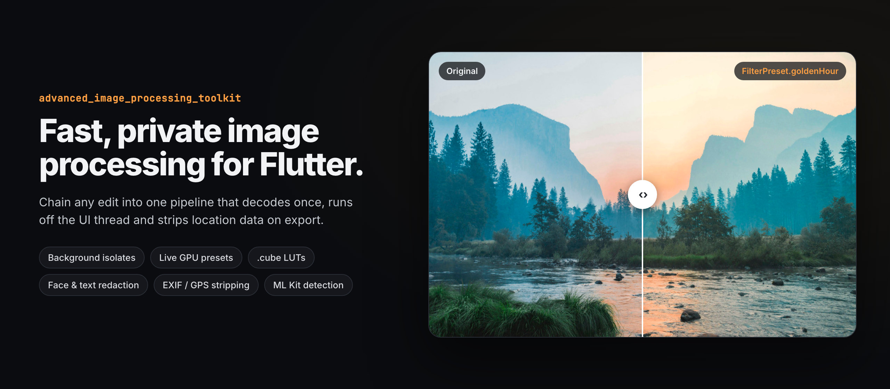
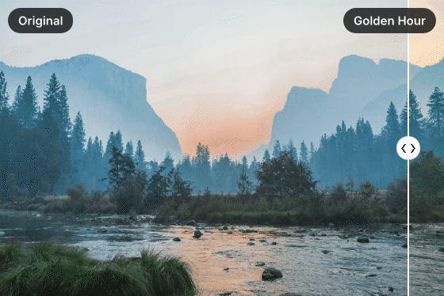
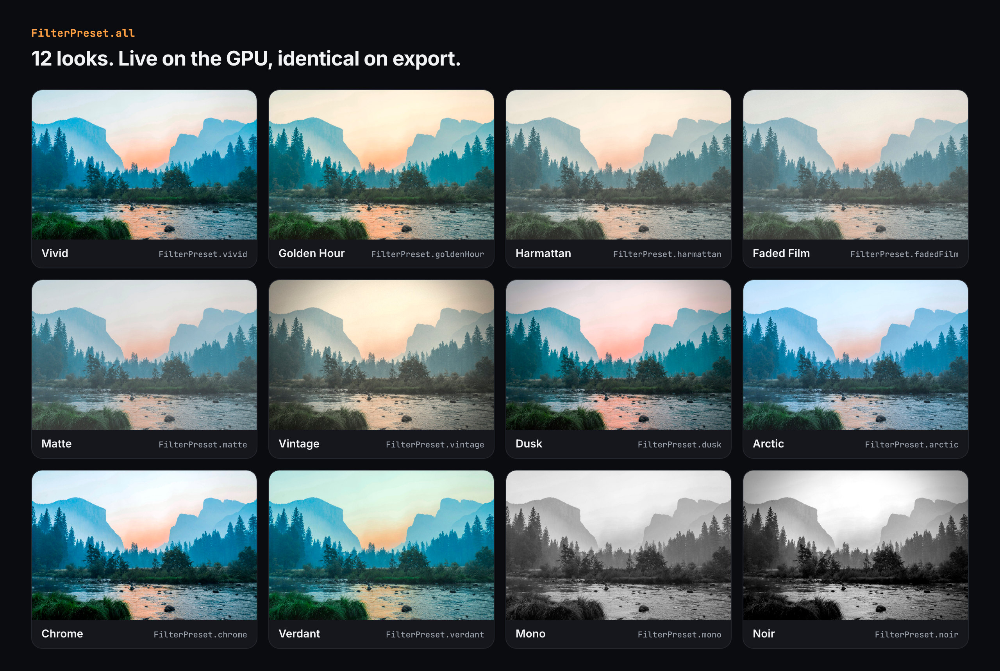
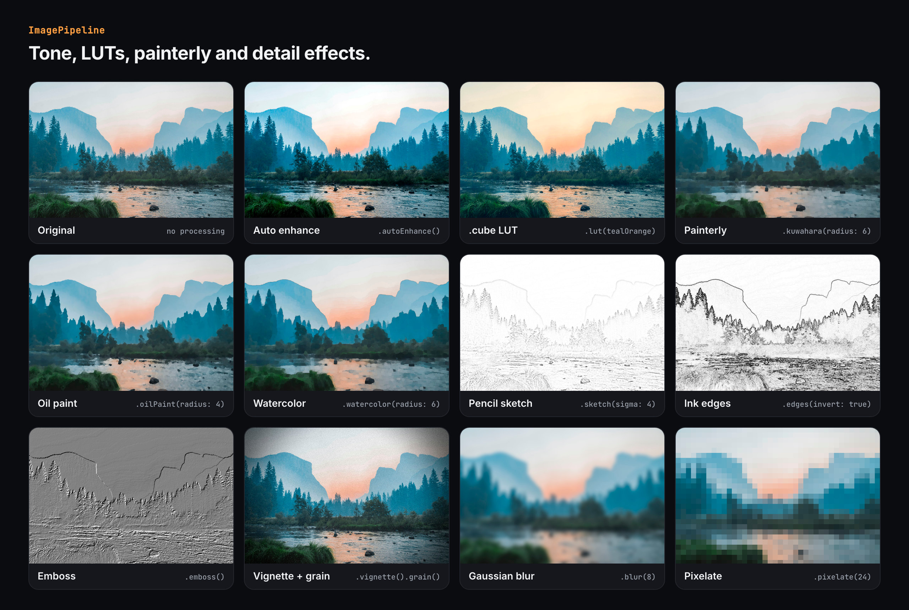
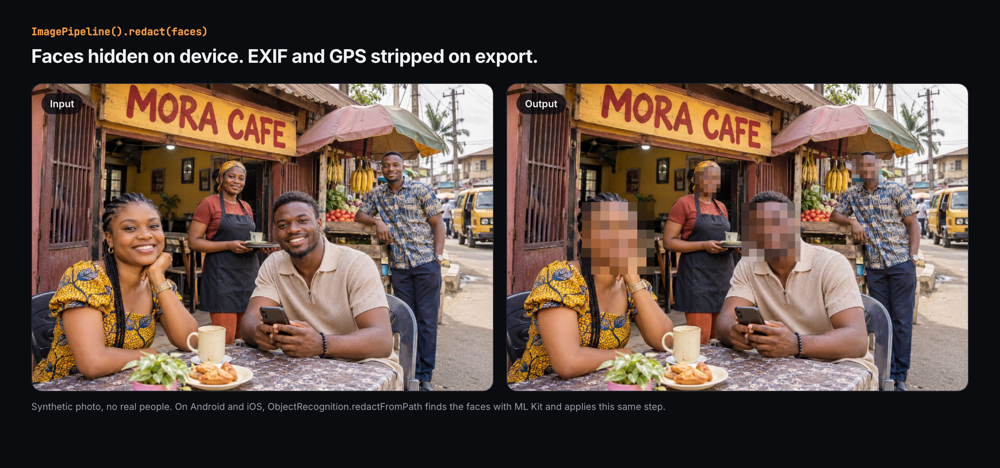
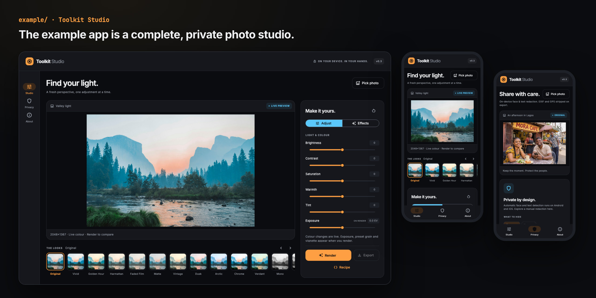

<p align="center">
  
</p>

# Advanced Image Processing Toolkit

[](https://pub.dev/packages/advanced_image_processing_toolkit)
[](https://github.com/emorilebo/advanced_image_processing/actions/workflows/ci.yml)
[](LICENSE)


Fast, private, on-device image processing for Flutter.

- **One decode, one encode.** Chain any number of steps in an `ImagePipeline`.
  Consecutive colour steps fuse into a single pass over the pixels.
- **Never blocks the UI.** Pipelines run on a background isolate on Android,
  iOS and desktop.
- **Live previews that match the export.** Presets and colour adjustments
  render on the GPU with `ColorFiltered`, using the same matrix the
  pipeline applies when you save.
- **Professional colour.** Load `.cube` LUTs straight from DaVinci Resolve,
  Premiere or Photoshop.
- **Private by default.** EXIF and GPS are stripped on export, faces and text
  can be redacted on device with ML Kit, and oversized uploads are refused
  before they can exhaust memory.
- **Correct output.** JPEG stays JPEG, PNG keeps its transparency, blur is
  alpha-aware, and photos come out upright.

<p align="center">
  
</p>

## Contents

- [Install](#install)
- [Quick start](#quick-start)
- [Presets and live preview](#presets-and-live-preview)
- [Effects](#effects)
- [LUTs](#luts)
- [Privacy: redaction and metadata](#privacy-redaction-and-metadata)
- [Detection](#detection)
- [Widgets](#widgets)
- [Recipes and batches](#recipes-and-batches)
- [Performance](#performance)
- [Example app](#example-app)
- [Migrating from 0.2.x](#migrating-from-02x)
- [Platform support](#platform-support)

## Install

```yaml
dependencies:
  advanced_image_processing_toolkit: ^0.3.0
```

Requires Dart 3.8 / Flutter 3.32 or newer. Image processing works on every
platform; ML Kit detection needs Android or iOS.

**iOS on Flutter 3.44+:** the `google_mlkit_*` 1.x packages ship through Swift
Package Manager only and need iOS 15. Turn SwiftPM on for your app and raise
the deployment target:

```yaml
# pubspec.yaml
flutter:
  config:
    enable-swift-package-manager: true
```

On Flutter 3.32 to 3.43 the 0.x ML Kit packages (CocoaPods) resolve instead.

## Quick start

```dart
import 'package:advanced_image_processing_toolkit/advanced_image_processing_toolkit.dart';

final result = await const ImagePipeline()
    .downscale(2048)                        // fewer pixels for every later step
    .autoEnhance()
    .then(FilterPreset.goldenHour.pipeline)
    .vignette(strength: 0.3)
    .run(photoBytes);

Image.memory(result.bytes);
print(result); // e.g. PipelineResult(2048x1367 jpeg, 401231 bytes, 412 ms)
```

A pipeline is an immutable recipe. Build it once and apply it to any number
of images; every builder call returns a new pipeline, so presets are safe to
share as constants.

Prefer one-liners? The 0.2.x API still works and now runs on the same
engine:

```dart
final gray = await ImageFilters.applyGrayscale(bytes);
```

## Presets and live preview



Twelve looks ship in `FilterPreset.all`. Each is a colour matrix (plus
optional vignette and grain), so a whole filter strip can preview live at
60 fps on the GPU:

```dart
ColorFiltered(
  colorFilter: FilterPreset.noir.toColorFilter(),
  child: Image.memory(original),
)
```

Slider adjustments compose the same way. Build the edit as a pipeline,
preview it with `toColorFilter()`, and export it with `run()`. The exported
pixels match the preview to within rounding, because Flutter's
`ColorFilter.matrix` and the engine use the same convention.

```dart
final edit = const ImagePipeline()
    .colorMatrix(FilterPreset.vivid.matrix)
    .temperature(warmth)      // -1..1
    .contrast(contrast);      // 1.0 is neutral

ColorFiltered(colorFilter: edit.toColorFilter()!, child: preview);
final saved = await edit.run(original);
```

`toColorFilter()` returns `null` once a pipeline contains a step that is not
a pure colour transform (blur, vignette and so on). Those steps appear when
you render.

## Effects



| Group | Steps |
| --- | --- |
| Colour (fused, GPU-previewable) | `brightness` `contrast` `saturation` `hue` `temperature` `tint` `grayscale` `sepia` `invert` `colorMatrix` |
| Tone | `exposure` (linear light) `gamma` `levels` `posterize` `threshold` `autoLevels` `autoWhiteBalance` `autoEnhance` `lut` |
| Detail | `blur` `sharpen` (unsharp mask) `edges` (Sobel) `emboss` |
| Artistic | `vignette` `grain` (seeded) `pixelate` `kuwahara` `oilPaint` `watercolor` `sketch` |
| Geometry | `resize` (contain / cover / fill) `downscale` `rotate` `flip` `crop` `cropToAspect` |
| Privacy and composition | `redact` (pixelate / blur / fill) `watermark` (anchored, scaled, with opacity) |
| Escape hatch | `custom(name, transform)` for any `package:image` function |

Blur, Kuwahara and oil paint use linear-time algorithms, so a large radius
costs about the same as a small one.

```dart
await const ImagePipeline()
    .watermark(logoPng, anchor: WatermarkAnchor.bottomRight, widthFraction: 0.18, opacity: 0.8)
    .run(photo, output: const OutputFormat.jpeg(quality: 85));
```

## LUTs

```dart
final lut = CubeLut.parse(await rootBundle.loadString('assets/luts/film.cube'));

final graded = await const ImagePipeline()
    .lut(lut, intensity: 0.8)   // blend with the original
    .run(photo);
```

3D (`LUT_3D_SIZE`) and 1D (`LUT_1D_SIZE`) tables are supported, with
trilinear interpolation, `DOMAIN_MIN` / `DOMAIN_MAX`, and size limits that
stop a malformed file from forcing a huge allocation.

## Privacy: redaction and metadata



Find and hide faces on device in one call (Android and iOS):

```dart
final redacted = await ObjectRecognition.redactFromPath(
  photoPath,
  targets: {DetectorType.face, DetectorType.text},
  style: RedactionStyle.fill,
);
upload(redacted.bytes); // EXIF and GPS already stripped
print('${redacted.regions.length} regions hidden');
```

Or redact regions you already have, on any platform:

```dart
await const ImagePipeline()
    .redact(detections.map((d) => d.region), style: RedactionStyle.pixelate)
    .run(bytes);
```

> **Choosing a style.** Pixelation and blur look natural for faces in
> casual photos, but neither is irreversible: recognition models can
> sometimes identify blurred faces, and tools like Depix have recovered
> pixelated text from screenshots. For text, documents and anything sensitive, use
> `RedactionStyle.fill`.

**Metadata.** Every run applies a `MetadataPolicy`:

| Policy | Result |
| --- | --- |
| `strip` (default) | No EXIF at all |
| `keepWithoutLocation` | Camera and capture data kept, GPS removed |
| `keep` | Everything except the orientation tag (pixels are already upright) |

**Untrusted input.** `run()` reads the image header first and throws
`ImageTooLargeException` above `maxInputPixels` (64 MP by default), before
allocating pixel memory. Undecodable bytes throw `UnsupportedImageException`.

## Detection

```dart
final faces = await ObjectRecognition.detectFaces(path);
final all = await ObjectRecognition.detectObjectsFromPath(
  path,
  detectors: {DetectorType.object, DetectorType.text}, // only what you need
);
```

Only the detectors you ask for are created, and they run concurrently. Each
`DetectedObject` has a `type`, a `label`, a `boundingBox` in image pixels,
and detector-specific `additionalData` (smile probability, OCR text, pose
landmarks). Call `ObjectRecognition.dispose()` to free native resources;
detectors are recreated on next use.

## Widgets

```dart
// Draggable before/after, accessible as an adjustable slider.
ImageCompareSlider(
  before: Image.memory(original, fit: BoxFit.cover),
  after: Image.memory(edited, fit: BoxFit.cover),
  beforeLabel: const Text('Before'),
  afterLabel: const Text('After'),
)

// Detection boxes drawn correctly for any BoxFit.
DetectionOverlay(
  imageSize: Size(width.toDouble(), height.toDouble()),
  detections: detections,
  fit: BoxFit.contain,
  child: Image.file(file, fit: BoxFit.contain),
)
```

`DetectionOverlay.mapRect` exposes the same image-to-widget mapping for
hit-testing taps.

## Recipes and batches

Pipelines serialise to JSON, so users can save, sync and share edits:

```dart
final json = jsonEncode(pipeline.toJson());
final restored = ImagePipeline.fromJson(jsonDecode(json) as Map<String, Object?>);
```

Process many images across isolates, keeping input order:

```dart
final results = await FilterPreset.vintage.pipeline.runAll(photos, concurrency: 3);
```

Already on a background isolate or a server? Use `runSync`, or import
`package:advanced_image_processing_toolkit/engine.dart`, which has no
Flutter dependency.

## Performance

Measured with `tool/benchmark.dart`, AOT-compiled, median of 3 runs, on a
10.7 MP photo (4000x2670) on an Apple Silicon Mac. Phones are slower in
absolute terms; the ratios are what carry over.

| Task | 0.2.x | 0.3.0 | Speed-up |
| --- | ---: | ---: | ---: |
| 5-step look (contrast, saturation, sepia, vignette, blur) | 10.9 s | 2.7 s | 4.1x |
| Same look with `downscale(2048)` first | 10.9 s | 2.1 s | 5.1x |
| Gaussian blur, radius 16 (pixels only) | 3.4 s | 0.57 s | 6.0x |
| Gaussian blur, radius 48 (pixels only) | 9.2 s | 0.61 s | 14.9x |
| Oil paint, 2 MP | 8.1 s | 0.66 s | 12.2x |

On device, 0.2.x also made a failed platform-channel call before every
filter, which this pure-Dart benchmark cannot include, and it ran on the UI
isolate, so the app froze for the whole duration. Both are gone in 0.3.0.

JPEG decoding dominates large inputs, so the biggest practical win is to put
`downscale()` first whenever you don't need full resolution.

Reproduce:

```sh
dart compile exe tool/benchmark.dart -o /tmp/aipt_bench && /tmp/aipt_bench
```

## Example app



`example/` is **Toolkit Studio**, a complete photo editor built only on this
package: live presets and adjustments, render with a before/after slider,
a recipe viewer, export, and on-device redaction.

```sh
cd example && flutter run
```

## Migrating from 0.2.x

Your code compiles unchanged. A few results differ, all on purpose:

- **Format.** Output keeps the input format (PNG stays PNG with
  transparency). 0.2.x always produced JPEG.
- **Metadata.** EXIF, including GPS, is stripped. Pass
  `metadata: MetadataPolicy.keep` to a pipeline run if you need it.
- **JPEG quality** defaults to 90 instead of 100: much smaller files with no
  visible difference.
- **Fixed behaviour.** `adjustBrightness` now brightens instead of turning
  the image white or black; watermark `opacity` and watercolour `intensity`
  are applied; oil painting uses the correct algorithm.
- **Vignette** uses a smooth falloff where `radius` is where darkening starts.
- **AR** (`AugmentedReality`) is deprecated. It never had a native
  implementation and always returned `false`; it will be removed in 0.4.0.

For anything with more than one step, switch to `ImagePipeline`: it decodes
and encodes once instead of once per call.

## Platform support

| | Android | iOS | Web | macOS / Windows / Linux |
| --- | :---: | :---: | :---: | :---: |
| `ImagePipeline`, presets, LUTs, redaction | Yes | Yes | Yes (runs inline) | Yes |
| Background isolate | Yes | Yes | No | Yes |
| GPU live preview (`toColorFilter`) | Yes | Yes | Yes | Yes |
| ML Kit detection, `redactFromPath` | Yes | Yes | No | No |

## API reference

See [API_REFERENCE.md](API_REFERENCE.md) and the generated docs on
[pub.dev](https://pub.dev/documentation/advanced_image_processing_toolkit/latest/).

## Contributing

```sh
flutter test                         # package tests
(cd example && flutter test)         # example app tests
tool/readme_assets/render.sh         # regenerate the README images
```

Every image in this README is real output of the package, regenerated by
`tool/readme_assets/render.sh`. The cafe photo is synthetic; no real people
appear in it.

## Author

**Godfrey Lebo**

- Email: [emorylebo@gmail.com](mailto:emorylebo@gmail.com)
- Portfolio: [godfreylebo.dev](https://www.godfreylebo.dev/)
- LinkedIn: [godfreylebo](https://www.linkedin.com/in/godfreylebo/)
- GitHub: [@emorilebo](https://github.com/emorilebo)

## License

MIT. See [LICENSE](LICENSE).
